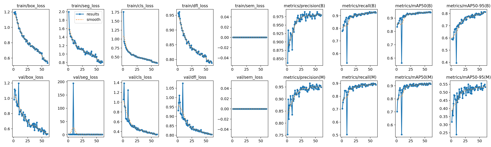
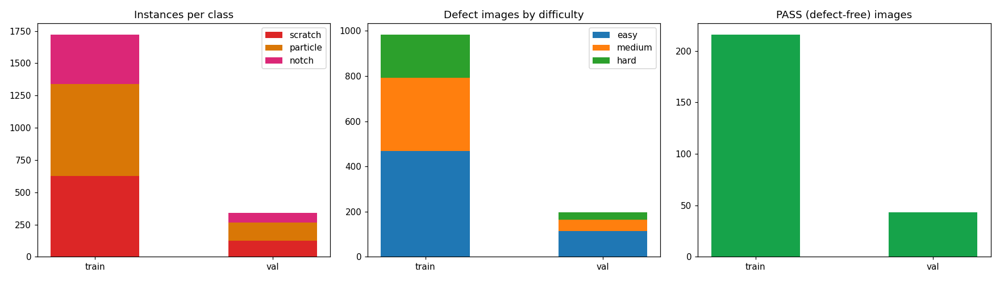

# 半导体晶圆表面缺陷检测系统

基于 **YOLOv8-seg 实例分割**的半导体晶圆表面缺陷检测系统，覆盖**数据合成 → 模型训练 → Web 在线检测**端到端流程，支持划痕、颗粒、缺口三类缺陷的像素级分割、PASS/FAIL 良率判定与产线级统计看板。

    

## 模型性能

在 240 张验证集（660 个缺陷实例，含微小/低对比度困难样本与无缺陷负样本）上的表现：

| 指标 | Box（检测框） | Mask（分割掩码） |
|---|---|---|
| Precision | 0.989 | 0.954 |
| Recall | 0.924 | 0.894 |
| **mAP@0.5** | **0.944** | **0.918** |
| mAP@0.5:0.95 | 0.813 | 0.555 |

分类别检出精度（Box mAP50）：划痕 **0.991** · 颗粒 **0.944** · 缺口 **0.897**

单张推理约 **40ms**（RTX 4060 GPU，含前后处理）。



## 系统特性

- **三类缺陷像素级分割**：划痕（直线/折线/弧线）、颗粒（单体/聚簇）、边缘缺口，输出分割掩码与缺陷几何信息（位置/尺寸/面积）
- **按类别独立置信度过滤**：三类缺陷各自设置最低置信度阈值，服务端真实过滤并联动 PASS/FAIL 判定与统计
- **可选超分增强**：Real-ESRGAN 4x 超分辨率，提升微小缺陷检出能力（约增加 2s 计算开销）
- **产线级统计看板**：总体良率、缺陷类型分布、严重程度分布、检测历史回溯
- **工程细节**：模型启动时全局单例加载 + GPU 预热（消除首次请求 5s+ 延迟）、训练断点续训、中文路径兼容

## 快速开始

### 环境要求

- Python 3.10（建议使用 Conda 管理环境）
- NVIDIA GPU（CUDA 12.1+），无 GPU 时自动回退 CPU

### 安装与启动

```bash
# 1. 创建环境
conda create -n pytorch python=3.10 -y
conda activate pytorch

# 2. 安装依赖
pip install torch torchvision --index-url https://download.pytorch.org/whl/cu121
pip install ultralytics fastapi uvicorn python-multipart opencv-python realesrgan

# 3. 生成数据集（如需重新训练）
python scripts/generate_dataset.py

# 4. 启动服务
python app.py
# Windows 下可直接双击 start.bat
```

浏览器访问 **http://localhost:8000** 即可使用；API 文档见 http://localhost:8000/docs 。

### 重新训练

```bash
# 完整训练（GPU：RTX 4060 约 60 分钟）
python scripts/train.py --epochs 60 --batch 16 --size s --device 0

# 训练中断后从断点恢复
python scripts/resume_train.py
```

## 数据集

数据集由参数化管线合成（固定随机种子，完全可复现），模拟真实产线数据分布：

| 属性 | 说明 |
|---|---|
| 规模 | 训练 1200 张 + 验证 240 张（640x640） |
| 负样本 | 约 18% 无缺陷 PASS 图像（考核模型误报率） |
| 难度分层 | easy 50% / medium 30% / hard 20%（微小尺寸、低对比度） |
| 图像真实性 | 芯片阵列网格、渐晕光照、高斯噪声、晶圆平边 |



> **设计要点**：v1 数据集（300 张、每张必含缺陷、形态单一）训练出的模型 mAP50 虚高至 0.985 但泛化存疑；v2 引入负样本与难度分层后指标回落至 0.944，但在微小缺陷、低对比度等困难样本上表现稳定——数据集质量决定指标含金量。

## 项目结构

```
wafer-defect-detection/
├── app.py                     # 应用入口（依赖检查、服务启动）
├── backend/
│   └── main.py                # FastAPI 路由（检测/健康检查/静态资源）
├── models/
│   ├── defect_detector.py     # YOLOv8-seg 检测器封装（单例加载、GPU 预热）
│   └── super_resolution.py    # Real-ESRGAN 超分模块
├── frontend/
│   └── index.html             # Web 检测界面（上传/参数/看板/历史）
├── scripts/
│   ├── generate_dataset.py    # 数据集合成管线（难度分层、负样本）
│   ├── train.py               # 训练脚本
│   ├── resume_train.py        # 断点续训
│   ├── batch_detect.py        # 批量检测
│   └── smoke_test.py          # 端到端冒烟测试
├── runs/train/wafer_defect_seg/
│   ├── weights/best.pt        # 最优模型权重
│   └── results.png            # 训练曲线
├── weights/                   # 历史版本权重备份
└── wafer_config.yaml          # 全局配置
```

## API

| 方法 | 路径 | 说明 |
|---|---|---|
| POST | `/api/detect` | 检测晶圆图（multipart 上传，支持按类别置信度过滤参数） |
| GET | `/api/health` | 服务健康检查（含模型就绪状态） |
| GET | `/docs` | 交互式 API 文档（Swagger UI） |

## 技术栈

`PyTorch` · `Ultralytics YOLOv8-seg` · `Real-ESRGAN` · `FastAPI` · `Uvicorn` · `OpenCV` · `HTML/CSS/JS + Chart.js`
